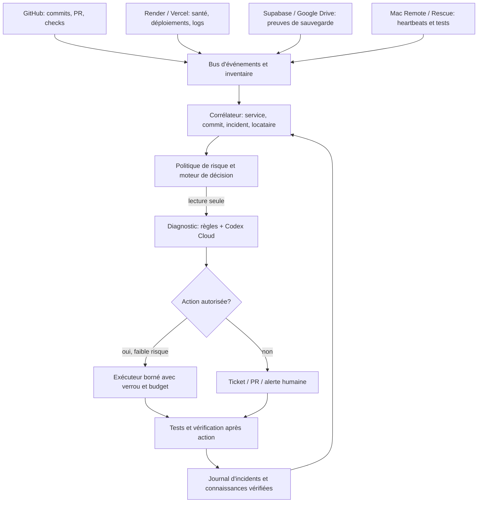

# Architecture Kenbot Auto-Repair intelligent V3

**Statut : architecture cible — non déployée.** Date : 23 octobre 2026.
**Dépôts :** [kenbot-runner](https://github.com/luxurahair/kenbot-runner) (orchestration) et [kenebec-ai](https://github.com/luxurahair/kenebec-ai) (application et services).
**Principe :** observer → qualifier → diagnostiquer → choisir une intervention autorisée → vérifier → apprendre de l'incident. Les changements de code restent soumis à une PR, à des tests et à une approbation humaine avant fusion en production.

## 1. Ce qui existe réellement (V2)

| Composant | Existant | Limite |
|---|---|---|
| GitHub Actions `.github/workflows/auto-repair.yml` | Tests offline puis contrôle périodique, toutes les 15 minutes | Pas d'orchestration globale multi-service |
| `monitoring/safe_monitor.py` | Classification HTTP, délais et tentatives bornées | Contrôle limité aux URL configurées |
| `monitoring/repair_planner.py` | Décisions prudentes et propositions de diagnostic Codex/Mac | Pas de dispatch Codex ou Mac automatique |
| `monitoring/guarded_render_recovery.py` | Redémarrage Render ciblé, **opt-in**, contrôle d'identité, historique des déploiements et contrôle après action | Activation non confirmée; aucune récupération réelle démontrée |
| `monitoring/backup_guard.py` | Contrôle local en lecture seule des archives de fonctionnalités critiques | Ne remplace pas la sauvegarde quotidienne des données |
| Mac Remote et Rescue | Canaux indépendants existants dans `kenebec-ai` | Pas de pilotage automatique par ce Runner |
| CI/CD GitHub | Tests et déploiements existants | La réussite CI ne prouve pas une réparation réelle |

**Activation Render V2 :** `KENBOT_AUTOREPAIR_ENABLED=1` et secret `RENDER_API_KEY`, après vérification de l'API, des permissions et du scénario de récupération. Sans cela, aucune intervention Render n'est autorisée. La présence de ces paramètres n'est pas vérifiée par ce document.

## 2. Architecture logique cible



**Séparation stricte :** le modèle d'IA peut expliquer, classer et proposer; seul un exécuteur déterministe avec une liste blanche peut agir. Le modèle ne reçoit pas d'accès shell générique, de jetons bruts ni de droit de fusion sur `main`.

## 3. Inventaire et responsabilités

| Domaine | Signal | Diagnostic | Actions possibles en V3 (non activées) |
|---|---|---|---|
| GitHub CI/CD | échecs, jobs bloqués, changements de fichiers | logs, SHA, dépendances, flakiness | relance bornée d'un job idempotent, PR de correction |
| Render API | HTTP, logs, déploiements, mémoire | erreur de code, déploiement, configuration ou réseau | redémarrage ciblé autorisé et vérifié; jamais de rollback aveugle |
| Vercel web | déploiement, preview, tests de parcours | diff entre version saine et candidate | preview et tests; promotion avec validation |
| Supabase | santé API, schémas, sauvegardes | migration, permission, intégrité, dérive | diagnostic seulement; aucune écriture automatique sur données clients |
| Google Drive | présence, âge, taille, empreinte d'archive | copie absente, incomplète ou non lisible | alerte et relance idempotente du backup selon procédure dédiée |
| Mac Remote | heartbeat, état `launchd`, commandes expirées | veille, réseau, daemon, jeton, crash | demande de diagnostic à Rescue, redémarrage local strictement autorisé |
| Codex Cloud | disponibilité du workflow et résultats | analyse de logs, proposition de patch | branche et PR isolées, jamais fusion sans validation |
| Android / iOS | builds, tests, distribution | régression de code ou permissions | tests/builds de validation; aucune publication Store non autorisée |
| Multi-SaaS | tenant, rôles, routes, accès | fuite inter-concession, mauvaise isolation | arrêt et escalade immédiate; aucune correction de données automatique |

**Périmètre :** l'application éducative familiale et les autres dépôts ne sont pas inclus par défaut. Ils nécessitent un manifeste et des autorisations séparés.

## 4. Se mettre à jour automatiquement quand le projet change

1. **Détection :** `push`, PR, fusion, nouveau workflow, migration SQL, changement de service Render/Vercel, modification de contrat API ou de dépendance mobile.
2. **Inventaire versionné :** un manifeste décrit chaque service : dépôt, branche, propriétaire, tenant, endpoints de santé, dépendances, tests requis, criticité et actions permises. La découverte seule ne confère jamais des droits d'écriture.
3. **Analyse d'impact :** comparer les fichiers changés à la carte des dépendances. Une modification VIN déclenche les tests VIN + évaluation + web/mobile concernés; une modification sauvegarde déclenche les tests backup + restauration isolée; un changement Android contacts déclenche les contrôles Play et sélecteur natif.
4. **Adaptation par PR :** Codex propose les mises à jour du manifeste, des tests et des runbooks dans une branche; vérification CI et revue avant fusion. Aucune modification automatique du code de production par le Runner.
5. **Évolution contrôlée :** versions de contrats `schema_version`, migrations explicites, rétrocompatibilité et historique de décisions. Une nouvelle intégration commence en lecture seule.
6. **Vérification de dérive :** inventaire nocturne des services réellement déployés comparé au manifeste; signaler toute différence de commit, version, permissions ou configuration.

**Exemple :** ajout d'une table Supabase critique → Kenbot détecte la migration → crée une proposition de mise à jour du périmètre de sauvegarde → tests de couverture et restauration sur base isolée → revue humaine → activation. Il ne déclare pas automatiquement que la table est sauvegardée.

## 5. Intelligence utile, mais vérifiable

- **Corrélation :** rapprocher une panne du dernier commit, déploiement, changement de secret, migration ou heartbeat, avec horodatage et niveau de confiance.
- **Mémoire des incidents :** stocker signature d'erreur, contexte, solution appliquée, résultat de tests, régression éventuelle, et liens de preuves. Ne pas stocker secrets, permis, SMS, contacts clients ou données personnelles.
- **Runbooks versionnés :** procédures par type d'incident; l'IA sélectionne une procédure, elle ne crée pas de commandes privilégiées au moment de l'exécution.
- **Apprentissage supervisé :** classer les diagnostics confirmés et les faux positifs; proposer de nouveaux tests ou règles via PR. Aucun entraînement sur les données clients.
- **Score de confiance :** signal faible = observation; panne répétée = diagnostic; réparation automatique seulement si la politique le permet et que les préconditions sont prouvées.
- **Coûts :** limiter appels Codex/LLM, tests, builds et redéploiements; ne pas déclencher une boucle de PR ou de runs.

## 6. Niveaux d'intervention

| Niveau | Permis | Exigence |
|---|---|---|
| 0 — Observer | health checks, logs expurgés, inventaire | lecture seule |
| 1 — Diagnostiquer | corrélation, synthèse Codex, ticket | données minimales et journal |
| 2 — Réparer sans risque métier | redémarrage d'un service explicitement autorisé | double preuve, verrou, cooldown, budget, contrôle après |
| 3 — Corriger le code | branche, patch, tests, preview, PR | revue et approbation avant `main` |
| 4 — Opération sensible | migration, rollback, suppression, restauration, release Store | approbation explicite, sauvegarde et plan de retour |
| Interdit | `git push --force`, `reset --hard` en production, écriture clients non autorisée, fuite inter-tenant | blocage permanent |

## 7. Séquence de récupération

```text
Incident reçu → identifier service + tenant + version
  → confirmer au moins deux observations indépendantes dans le temps
  → vérifier auth/404/429 (pas de redémarrage pour ces cas)
  → corréler dernier déploiement et incidents actifs
  → acquérir verrou distribué + vérifier budget et cooldown persistants
  → choisir runbook autorisé ou diagnostic Codex
  → si nécessaire, exécuter UNE action bornée
  → vérifier santé + parcours critique + absence de régression
  → enregistrer preuve et libérer verrou
  → si non résolu : arrêter, escalader, ne pas boucler
```

**Attention :** le workflow GitHub `concurrency` empêche les chevauchements du même groupe, mais ne constitue pas un verrou distribué entre GitHub, Render et Mac. V3 doit utiliser un verrou durable avec TTL, propriétaire et heartbeat.

## 8. Sauvegardes et restauration

La sauvegarde quotidienne de `kenebec-ai` est **distincte** du moteur d'autoréparation. Elle exporte les **13 tables configurées** (pas nécessairement l'intégralité de Supabase), en JSON GZIP, vers Supabase Storage et Google Drive. Politique déployée : rétention nominale 180 jours, protection des 14 copies les plus récentes, suppression limitée à 10 archives expirées par exécution et destination. Voir `kenebec-ai/docs/BACKUPS_ARCHITECTURE.md`.

V3 surveille : dernier succès, couverture des tables, taille, checksum, présence hors site et preuve de restauration sur environnement isolé. **Jamais de restauration automatique en production** ni de purge supplémentaire pour « réparer » une erreur.

## 9. Contrats techniques à créer

- `service-manifest.v1.json` : ID stable, environnement, tenant, owner, health URL, dépôt, dépendances, tests, actions autorisées.
- `incident.v1` : `incident_id`, `service_id`, `tenant_id`, `first_seen`, `last_seen`, `severity`, `status`, `commit_sha`, `evidence_refs`.
- `recovery-attempt.v1` : `attempt_id`, `incident_id`, `lease_id`, `runbook_version`, `approved_by`, `started_at`, `result`, `verification_refs`.
- `change-impact.v1` : `sha`, `paths`, `affected_services`, `required_tests`, `proposed_manifest_diff`.
- Journal immuable et expurgé, politiques d'accès minimales, audit par concession, clés en coffre GitHub/Render.

## 10. Plan de livraison, avec critères d'acceptation

| Phase | Livrable | Preuve exigée |
|---|---|---|
| A — Fondations (V2 existante) | moniteur et récupération Render opt-in | tests offline et workflow vert; récupération réelle encore non prouvée |
| B — Inventaire | manifeste + détection de dérive + carte de dépendances | tests sur changements simulés, aucune fausse action |
| C — Diagnostic intelligent | dispatch Codex contrôlé, analyse d'incident, PR automatique | PR créée sur branche sans fusion ni secret |
| D — Mac Rescue | contrat d'intervention indépendante et permissions minimales | panne simulée du daemon en environnement de test, rétablissement prouvé |
| E — Exécution | verrou persistant, cooldown durable, approbations, runbooks | tests de concurrence, coupure réseau, double exécution et échec de vérification |
| F — Production progressive | canary sur un seul service non critique, puis extension | récupération observée, rollback documenté, zéro perte et audit complet |

**Indicateurs :** délai de détection, délai de récupération, faux positifs, réparations vérifiées, incidents répétés, coût des runs, fraîcheur des sauvegardes, couverture des tests. Ne jamais promettre « 100 % » sans preuves sur une période représentative.

## 11. État à ne pas confondre

Cette architecture est **une spécification de V3**, pas un déploiement de V3. Les capacités d'auto-adaptation, de mémoire d'incidents, de dispatch Codex et de verrou distribué décrites ici **restent à construire et à tester**. Le seul exécuteur V2 existant est le redémarrage Render strictement limité et désactivé par défaut. Les sauvegardes quotidiennes et leur rétention continuent indépendamment.
